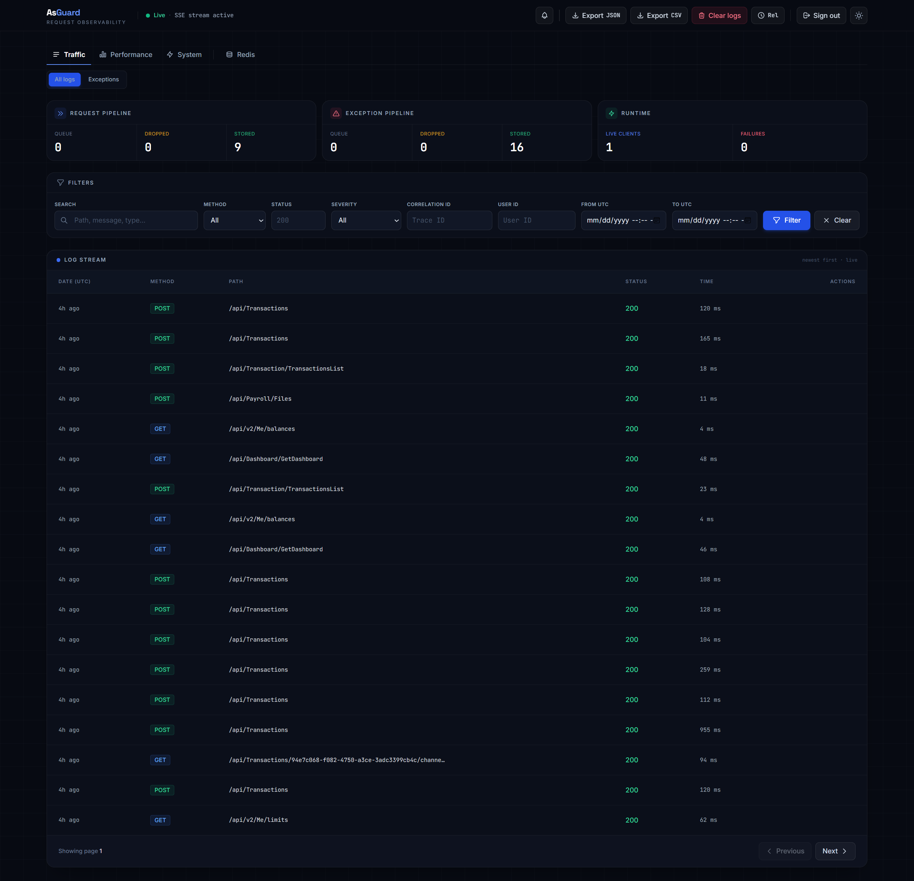

# AsGuard

[](https://www.nuget.org/packages/AsGuard/)
[](https://www.nuget.org/packages/AsGuard/)
[](https://dotnet.microsoft.com/)
[](LICENSE)

**AsGuard** is an all-in-one ASP.NET Core observability package providing HTTP request/response logging, exception tracking, automatic APM database & HTTP trace timelines, Redis management, host `ILogger` capture, proactive system alerting, and a built-in Razor dashboard with live Server-Sent Events (SSE) streaming.

No external telemetry collectors, agents, or third-party platforms required. Just install the package, configure your database, and get instant production-grade visibility.



---

## ⚡ Quick Setup

```bash
dotnet add package AsGuard
```

```csharp
using AsGuard.Domain.RequestLogging;
using AsGuard.Extensions;

var builder = WebApplication.CreateBuilder(args);

builder.Services.AddRequestLogging(options =>
{
    options.DatabaseProvider = LoggingDatabaseProvider.Sqlite;
    options.ConnectionString = "Data Source=asguard.db";
    options.DashboardUsername = "admin_ops";
    options.DashboardPassword = "change-me-please!";
});

var app = builder.Build();

app.UseRequestLogging(); // after HTTPS redirection / exception handling, before auth

app.Run();
```

Run your app and open `/request-logs-ui`. That's it — no Docker compose file, no external agent, no separate dashboard to stand up.

Need Redis, PostgreSQL, or APM tracing too? Full walkthrough below and in [docs/getting-started.md](docs/getting-started.md).

---

## ✨ Features at a Glance

| Category | Capability | Description |
| :--- | :--- | :--- |
| 🚀 **High Throughput** | Zero-Blocking Channel Pipeline | Non-blocking async queueing via `System.Threading.Channels`. Your API requests never wait on database writes. |
| 📊 **Built-In Dashboard** | Responsive Razor UI | Embedded assets (no external CDNs), instant light/dark mode, live log streaming, search, and date filters. |
| 🔐 **Hardened Security** | Session Auth & Anti-Brute-Force | Modern login page (no browser popups), sliding session cookies, IP-based login rate limiting, and CSRF token protection. |
| ⏱️ **APM & Tracing** | Zero-Config Spans & Gantt Charts | Automatic diagnostic interception of EF Core SQL queries and `HttpClient` calls, visualized as interactive Gantt timelines. |
| 🗄️ **Database Support** | Multi-Provider Storage | First-class persistence for **PostgreSQL**, **SQL Server**, **SQLite**, and **In-Memory** with automatic schema initialization. |
| 🔴 **Redis Management** | Safe Key Browser & Live Stats | Production-safe `SCAN` key browser, value editor (String, Hash, List, Set, ZSet), TTL modification, and live metrics. |
| 🔒 **Privacy & Masking** | PII Redaction & `[AsGuardMasked]` | Header redaction, body truncation limits, and JSON masking via property attributes or global keys. |
| 🎯 **Host `ILogger`** | Framework & Custom Log Capture | Seamlessly intercepts `ILogger<T>` warnings and errors with category filtering and live streaming console terminal. |
| 📈 **Deep Analytics** | Performance & User Leaderboards | Endpoint latency percentiles (`p50`, `p95`, `p99`), error rates, per-user request activity, and top slowest traces. |
| 🔔 **Proactive Alerts** | Multi-Channel Notifications | Monitors queue pressure, error spikes, and persistence failures with built-in Slack, Microsoft Teams, or custom webhooks. |
| 🧹 **Automated Retention**| Background Cleanup Workers | Configurable retention intervals for requests, exceptions, and trace spans to prevent unbounded table growth. |
| 📡 **REST API & Export** | Full Programmatic Access | RESTful endpoints for all monitoring metrics, diagnostic stats, and one-click CSV / JSON log exports. |

---

## 📦 Installation

Install the **AsGuard** package into your ASP.NET Core project (.NET 8, 9, or 10):

```bash
dotnet add package AsGuard
```

Or via the NuGet Package Manager:

```powershell
Install-Package AsGuard
```

---

## 🚀 Quick Start

Configure AsGuard in your `Program.cs` in under two minutes:

```csharp
using AsGuard.Domain.RequestLogging;
using AsGuard.Extensions;

var builder = WebApplication.CreateBuilder(args);

// 1. Add AsGuard monitoring services
builder.Services.AddRequestLogging(options =>
{
    // Storage Provider (SQLite requires zero database server setup)
    options.DatabaseProvider = LoggingDatabaseProvider.Sqlite;
    options.ConnectionString = "Data Source=asguard_logs.db";

    // Dashboard Credentials & Route
    options.DashboardRoute = "/request-logs-ui";
    options.DashboardUsername = builder.Configuration["AsGuard:Username"] ?? "admin_ops";
    options.DashboardPassword = builder.Configuration["AsGuard:Password"] ?? "SecurePassword123!";

    // Core Observability Features
    options.EnableExceptionLogging = true;
    options.CaptureHostLogs = true;
    options.EnableApmTracing = true;
    options.LogRequestBody = true;
    options.LogResponseBody = true;
});

var app = builder.Build();

// Standard ASP.NET Core middleware
if (!app.Environment.IsDevelopment())
{
    app.UseExceptionHandler("/error");
    app.UseHsts();
}

app.UseHttpsRedirection();

// 2. Register AsGuard middleware (after routing & exception handling, before endpoints)
app.UseRequestLogging();

app.UseAuthorization();

// Sample endpoint to verify logging
app.MapGet("/api/greeting", () => Results.Ok(new { message = "Hello from AsGuard-monitored API!" }));

app.Run();
```

Navigate to `https://localhost:<port>/request-logs-ui` in your browser. You will be greeted by the AsGuard login page. Enter your configured credentials to access the live dashboard!

> ⚠️ **Security Requirement**: AsGuard enforces strict startup credential checks. The legacy default credentials (`admin`/`admin`) are explicitly rejected in non-development environments. Always provide unique, strong credentials via configuration or environment variables.

---

## 🗄️ Database Provider Setup

AsGuard automatically creates and indexes all required database tables on startup. Choose the provider that matches your architecture:

### SQLite (Recommended for Development & Small Services)
```csharp
options.DatabaseProvider = LoggingDatabaseProvider.Sqlite;
options.ConnectionString = "Data Source=AsGuard.db";
```

### PostgreSQL
```csharp
options.DatabaseProvider = LoggingDatabaseProvider.PostgreSql;
options.ConnectionString = builder.Configuration.GetConnectionString("PostgreSqlConnection")!;
```

### SQL Server
```csharp
options.DatabaseProvider = LoggingDatabaseProvider.SqlServer;
options.ConnectionString = builder.Configuration.GetConnectionString("SqlServerConnection")!;
```

### In-Memory (Ephemeral Testing)
```csharp
options.DatabaseProvider = LoggingDatabaseProvider.InMemory;
options.MaxInMemoryEntries = 10_000;
```

---

## ⏱️ Automatic APM & Trace Timelines

AsGuard includes built-in Application Performance Monitoring that hooks directly into .NET's `DiagnosticListener` framework with **zero manual instrumentation**:

- **Entity Framework Core**: Intercepts SQL command texts, durations, offsets, and execution results.
- **HttpClient**: Automatically captures outgoing HTTP calls to third-party services and microservices.
- **Gantt Chart Timelines**: Visually traces database queries and external HTTP calls within each request details modal.
- **Slow Traces Tab**: Ranks the slowest queries and HTTP calls across all requests in a selectable window (`15m`, `1h`, `6h`, `24h`, `7d`).

```csharp
// APM is enabled by default. To adjust span retention:
options.EnableApmTracing = true;
options.ApmSpanRetentionDays = 7;
```

---

## 🔴 Redis Management & Live Metrics

AsGuard includes an opt-in **Redis Management** module embedded directly inside your dashboard:

- **Safe Key Browser**: Uses non-blocking `SCAN` iteration (never `KEYS`) with cursor pagination and binary key support.
- **Value Inspector & Editor**: View and update values for String, Hash, List, Set, and Sorted Set types.
- **TTL Control**: Inspect and modify expiration lifetimes on keys directly from the UI.
- **Multi-Rung Auto-Discovery**: Automatically discovers existing `IConnectionMultiplexer` registrations in DI, including Azure Cache for Redis authenticated via Microsoft Entra ID.
- **Live Server Metrics**: Real-time SSE streaming of server memory usage, connected clients, cache hit/miss ratio, and command throughput.

```csharp
options.EnableRedisManagement = true;
options.RedisManagementReadOnly = false; // Set true in production to prevent key mutations
```

---

## 🔒 Sensitive Data Protection & Masking

Protect personal identifiable information (PII) and sensitive credentials before they ever reach storage:

### 1. Attribute-Based Model Masking
Decorate properties on your DTOs or request models with `[AsGuardMasked]`:

```csharp
using AsGuard.Domain.RequestLogging;

public class LoginRequest
{
    public string Email { get; set; } = string.Empty;

    [AsGuardMasked]
    public string Password { get; set; } = string.Empty; // Replaced with "[REDACTED]" in logs
}
```

### 2. Global Key-Based & Header Redaction
```csharp
// Redact sensitive headers
options.SensitiveHeaders.Add("Authorization");
options.SensitiveHeaders.Add("X-Api-Key");

// Mask JSON properties anywhere in request/response bodies
options.SensitiveBodyKeys.Add("creditCardNumber");
options.SensitiveBodyKeys.Add("cvv");
options.SensitiveBodyKeys.Add("ssn");
```

---

## 🔔 Proactive Alerts & Webhooks

AsGuard's background monitor detects operational problems and dispatches alerts via configurable webhooks:

```csharp
// Alert when request queue fills beyond 80% capacity
options.QueuePressureAlertThreshold = 0.8;

// Alert when more than 20 exceptions occur within a 5-minute window
options.ExceptionSpikeAlertThreshold = 20;
options.ExceptionSpikeAlertWindow = TimeSpan.FromMinutes(5);

// Webhook delivery (Generic JSON, Slack, or Microsoft Teams)
options.AlertWebhookUrl = "https://hooks.slack.com/services/T00/B00/XXXX";
options.AlertWebhookFormat = AlertWebhookFormat.Slack;
options.AlertCooldown = TimeSpan.FromMinutes(5);
```

You can also implement `IAsGuardAlertSink` to direct alerts to any custom notification engine.

---

## 📚 Complete Documentation

Explore the comprehensive guides in the `docs/` folder:

| Guide | Description |
| :--- | :--- |
| 📖 **[Getting Started](docs/getting-started.md)** | Step-by-step setup guide, middleware ordering, and credential security. |
| ⚙️ **[Configuration Reference](docs/configuration.md)** | Exhaustive reference of all `RequestLoggingOptions` settings and defaults. |
| 🌐 **[HTTP Traffic Monitoring](docs/features/request-logging.md)** | Body capture, allowlists, JSON masking, and traffic sampling filters. |
| ⚠️ **[Exception & Host Log Tracking](docs/features/exception-tracking.md)** | Unhandled crashes, host `ILogger` integration, and manual `IExceptionLogger`. |
| ⏱️ **[APM & Distributed Traces](docs/features/apm-tracing.md)** | Diagnostic interception, Gantt timelines, and slow trace analysis. |
| 🔴 **[Redis Management](docs/features/redis-management.md)** | Key browsing, value editing, connection discovery, and real-time metrics. |
| 🔗 **[Enrichment & Correlation](docs/features/enrichment-correlation.md)** | Distributed correlation headers, user tagging, and DI-based enrichers. |
| 🖥️ **[Dashboard & Web API](docs/features/dashboard-api.md)** | Razor UI tour, session cookie security, rate limiting, and REST endpoints. |
| 🚨 **[Alerts & Production Operations](docs/features/alerts-production.md)** | Webhooks, Slack/Teams alerts, retention cleanup, and deployment guidelines. |

---

## 🤝 Contributing

We welcome community feedback, feature suggestions, and documentation improvements! Please review our [Contribution Guidelines](CONTRIBUTING.md) before submitting issues or pull requests.

---

## 📄 License

AsGuard is free for production use under a source-available license. You are permitted to integrate and deploy AsGuard into commercial and open-source applications. See [LICENSE](LICENSE) for full details.

---

**⭐ If AsGuard helps you monitor your ASP.NET Core applications, please star this repository!**
