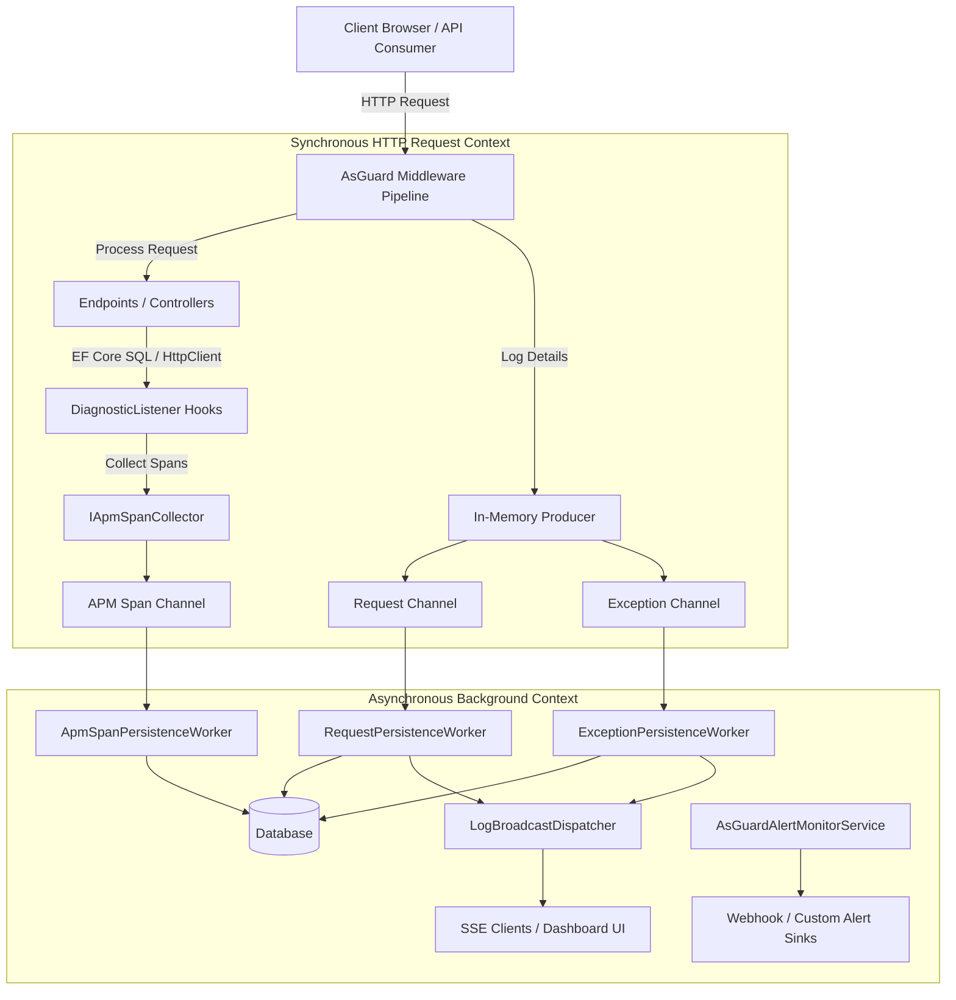

# AsGuard Documentation

Welcome to the official documentation for **AsGuard** – a high-performance, developer-friendly ASP.NET Core monitoring package for request/response logging, unhandled exception tracking, host `ILogger` capture, automatic APM database & HTTP trace timelines, Redis management, and built-in dashboard observability.

AsGuard is designed for modern .NET teams who need **immediate, practical visibility** into HTTP traffic, unhandled errors, slow SQL queries, external HTTP client dependencies, and cache states without the overhead of wiring up complex, multi-layered observability platforms (like Prometheus, Elasticsearch, or Jaeger) in development or production.

---

## Technical Specifications & License

*   **Target Frameworks**: .NET 8, .NET 9, and .NET 10.
*   **License**: Source-available (completely free for production use).
*   **Hosting Requirements**: Compatible with any ASP.NET Core hosting model (Kestrel, IIS, HTTP.sys) using `WebApplication` or standard startup pipelines.
*   **Package URI**: [AsGuard on NuGet](https://www.nuget.org/packages/AsGuard/)
*   **Author**: Mahmood Alsarraj

---

## Core Architectural Overview

AsGuard is engineered with a **zero-blocking, high-throughput philosophy**. Traditional request logging libraries block the active HTTP request execution thread while writing logs to a database or disk, adding significant latency. 

AsGuard uses a modern, asynchronous producer-consumer architecture utilizing **`System.Threading.Channels`**:

### The Pipeline in Detail:
1.  **Request Middleware**: When an HTTP request enters your application, AsGuard generates/propagates correlation IDs (`X-Correlation-ID` and W3C `traceparent`), measures duration, inspects headers, executes custom enrichers, and optionally captures request/response bodies (applying high-speed JSON masking rules dynamically).
2.  **Diagnostic Interception**: `AsGuardDiagnosticsSubscriber` attaches to native .NET `DiagnosticListener` instances, automatically capturing execution timings and details for Entity Framework Core SQL queries and downstream `HttpClient` calls without manual code changes.
3.  **Bounded Channel Queues**: Instead of saving directly to the database, AsGuard writes request logs, exceptions, and APM spans directly into internal memory queues managed by `System.Threading.Channels`. This is a lock-free, high-performance operation taking sub-microsecond time.
4.  **Background Persistence Workers**: Long-running `IHostedService` workers run in the background. They drain the channels, aggregate logs, apply retry backoff to absorb transient database blips, and save records in optimized bulk transactions to your database of choice (SQL Server, PostgreSQL, SQLite, or In-Memory).
5.  **Live Stream Dispatcher**: New events are dispatched in real time over a high-performance **Server-Sent Events (SSE)** stream directly to active dashboard sessions without requiring WebSockets or SignalR.
6.  **Proactive Monitoring & Cleanup**: `AsGuardAlertMonitorService` tracks diagnostic counters, dispatching alerts to webhooks (Slack, Teams, Generic JSON) when queue pressure spikes or persistence fails. Concurrently, `LogRetentionCleanupWorker` runs periodically to prune aged records.

---

## Feature Checklist

AsGuard comes packed with enterprise-grade observability features out of the box:

*   **Traffic Monitoring**: Logs HTTP request method, path, query parameters, status codes, user identifiers, and execution duration.
*   **Body Capture**: Opt-in capture of request and response bodies up to configurable limits, restricted to defined content types (e.g., `application/json`).
*   **Data Security**: Always-on redaction of sensitive headers like `Set-Cookie`. Configurable `SensitiveHeaders` collection.
*   **JSON Data Masking**: Dynamic assembly scanning at startup for the `[AsGuardMasked]` attribute and manual property key configuration (`SensitiveBodyKeys`) to replace credentials or PII with `[REDACTED]` prior to storage.
*   **Error & Log Capture**: Unhandled HTTP exceptions are recorded automatically with complete stack traces. Plus, a built-in `ILoggerProvider` registers to redirect application warnings/errors to your logs dashboard.
*   **Manual Logging**: The `IExceptionLogger` interface allows you to queue warnings, errors, and handled exceptions from background workers, scheduled cron jobs, or event consumers.
*   **APM & Trace Timelines**: Automatic zero-config interception of EF Core SQL queries and outgoing `HttpClient` calls, rendered as pure CSS/HTML Gantt chart timelines in the dashboard.
*   **Slow Trace Analysis**: Cross-request ranking of the slowest database queries and external HTTP calls across selectable time ranges (`15m`, `1h`, `6h`, `24h`, `7d`).
*   **Redis Management**: Embedded Redis tab featuring safe `SCAN` key browsing (never `KEYS`), value inspection/editing for String, Hash, List, Set, and Sorted Set types, TTL management, multi-rung connection auto-discovery (including Azure Cache with Entra ID), and real-time SSE metrics.
*   **Performance & User Leaderboards**: Ranks endpoints by latency percentiles (`p50`, `p95`, `p99`), error rate, and volume; ranks authenticated users by request count, failure rate, and p95 latency.
*   **Log Enrichment & Correlation**: Distributed correlation ID header propagation (`X-Correlation-ID`), W3C `traceparent` support, claims-based user tracking (`sub`, `NameIdentifier`), inline enricher delegates (`EnrichLog`), and dependency injection-based scoping via `IAsGuardRequestEnricher`.
*   **Built-in Razor Dashboard**: A full-featured, secure dashboard supporting light and dark modes, instant search, UTC date filtering, severity filters, live SSE stream updates, "Copy as cURL", correlation drill-down, CSV/JSON export, and data-clear options.
*   **Session-Based Dashboard Security**: Secure login page (no browser Basic Auth popups), encrypted session cookie authentication (`DashboardSessionService`), IP-based login rate limiting (`DashboardLoginRateLimiter`), and CSRF protection headers (`X-AsGuard-Request`).
*   **Comprehensive Web API**: Under the hood, the dashboard is powered by a fully documented, Basic-Auth / session-cookie protected REST API which includes runtime stats, diagnostic counters, and health metrics.
*   **Automated Retention**: An automated background cleaner deletes request, exception, and APM trace records older than a configured number of days (`RequestRetentionDays`, `ExceptionRetentionDays`, `ApmSpanRetentionDays`).
*   **Proactive Alerting & Webhooks**: Built-in rules trigger alerts on high queue pressure, exception spikes, database persistence failures, or live streaming problems. Includes native Slack, Teams, and generic JSON webhook support and an in-memory alert history browser.

---

## Documentation Directory

Explore the complete guide to mastering AsGuard in your environment:

1.  **[Getting Started](getting-started.md)**: Add AsGuard to a new or existing ASP.NET Core project in under 5 minutes.
2.  **[Configuration Reference](configuration.md)**: Explore all options for storage, queues, security, retention, and performance tuning.
3.  **[HTTP Traffic Monitoring](features/request-logging.md)**: Learn about body capture, JSON masking, header redaction, and traffic sampling filters.
4.  **[Exceptions & Host Logs](features/exception-tracking.md)**: Understand unhandled errors, manual logging, and Microsoft logging integration.
5.  **[APM & Trace Timelines](features/apm-tracing.md)**: Trace database queries (EF Core) and downstream calls (HttpClient) with Gantt charts and slow trace rankings.
6.  **[Redis Management](features/redis-management.md)**: Browse and edit keys with `SCAN`, inspect values, manage TTLs, and stream live server metrics.
7.  **[Enrichment & Correlation](features/enrichment-correlation.md)**: Group related processes, propagate distributed traces, and tag logs with user metadata.
8.  **[Dashboard & Web API](features/dashboard-api.md)**: Tour the Razor dashboard, session security, rate limiting, and the complete REST API.
9.  **[Alerts & Production Operations](features/alerts-production.md)**: Set up custom alert channels (Slack/Teams), monitor health, and follow production checklists.
